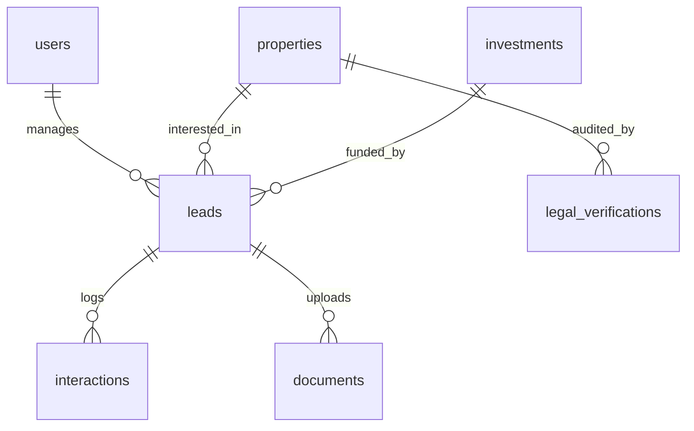

# MS Legacy — CRM Foundation Plan

This plan establishes the architecture and data schemas for the private **MS Legacy CRM Dashboard**, designed to capture, verify, track, and close high-value real estate leads, properties, and project share investments.

---

## 1. User Roles & Access Control
The CRM will implement a Role-Based Access Control (RBAC) model to secure sensitive client data, documents, and transaction logs:

| Role | Access Level | Responsibilities |
| :--- | :--- | :--- |
| **SuperAdmin / Founder** | Full System Control | Monitor dashboard metrics, manage team roles, approve partnerships, audit transaction records. |
| **Sales Manager** | Lead & Property Read/Write | Onboard leads, allocate deals, coordinate site visits, log customer interactions. |
| **Legal Officer** | Legal & Document Verification | Upload titles, write verification reports, rate Legal Scores, manage compliance checklists. |
| **Property Manager** | Property Care & Rental Management | Track active rentals, log maintenance tasks, manage tenant documents and utilities. |
| **Channel Partner (Broker)** | Restricted Portal Access | Submit referral leads, track referral conversion status, view authorized project catalogs. |

---

## 2. Lead Capture & Lifecycle Stages
Leads entering from the public website (contact forms, calculators, download assets) will flow through a standardized lifecycle:

```
[New Lead] ➔ [Contacted/Assigned] ➔ [Site Visit Scheduled] ➔ [Site Visit Completed]
                                                                      │
                                                                      ▼
[Closed Lost] ◀── [Negotiation/JV Scope] ◀── [Legal Due Diligence] ◄──┘
      │
      ▼
[Closed Won] ➔ [Registration Process] ➔ [Asset Onboarded / Closed]
```

*   **Lead Stages**:
    1.  `New`: Auto-captured from public forms.
    2.  `Contacted`: Verified contact info; assigned to Sales Manager.
    3.  `Site Visit Scheduled`: Date, time, and property details logged.
    4.  `Site Visit Completed`: Client feedback captured.
    5.  `Legal Due Diligence`: Title verification or KYC auditing in progress.
    6.  `Negotiation`: Pricing, booking token details, and agreements discussed.
    7.  `Booking Confirmed`: Advance payment received.
    8.  `Registration In Progress`: Draft deeds submitted to Stamps and Registration dept.
    9.  `Closed Won (Closed)`: Property registered; sale complete.
    10. `Closed Lost`: Lead archived (with reasons logged: Price, Location, Legal Issue).

---

## 3. Core Database Tables (PostgreSQL / Supabase Schema)
To build a scalable CRM foundation, we propose the following relational database schema structure:



### Table definitions:

#### 1. `profiles` (User Profiles & Roles)
*   `id` (uuid, primary key, links to auth.users)
*   `full_name` (text)
*   `role` (enum: 'superadmin', 'sales_manager', 'legal_officer', 'property_manager', 'partner')
*   `phone` (varchar)
*   `created_at` (timestamp)

#### 2. `leads` (Customer Leads & Profiles)
*   `id` (uuid, primary key)
*   `full_name` (text)
*   `email` (varchar)
*   `phone` (varchar)
*   `nri_status` (boolean)
*   `lead_source` (varchar: 'website', 'partner_referral', 'direct')
*   `lead_stage` (varchar: 'new', 'contacted', 'site_visit_scheduled', 'site_visit_completed', 'legal_due_diligence', 'negotiation', 'booking_confirmed', 'registration', 'closed_won', 'closed_lost')
*   `budget_min` (numeric)
*   `budget_max` (numeric)
*   `preferred_asset_type` (varchar: 'residential_plot', 'bda_site', 'villa', 'apartment', 'commercial_plot', 'office_space', 'farm_land', 'project_share')
*   `assigned_to` (uuid, foreign key to profiles.id)
*   `partner_id` (uuid, foreign key to profiles.id, nullable)
*   `created_at` (timestamp)

#### 3. `properties` (Property Registry)
*   `id` (uuid, primary key)
*   `title` (text)
*   `location` (text)
*   `price` (numeric)
*   `dimensions` (varchar)
*   `category` (varchar)
*   `rera_number` (varchar)
*   `wealth_score` (numeric, 0.0 to 10.0)
*   `score_location` (numeric)
*   `score_legal` (numeric)
*   `score_infrastructure` (numeric)
*   `score_connectivity` (numeric)
*   `status` (varchar: 'available', 'reserved', 'sold', 'under_management')
*   `created_at` (timestamp)

#### 4. `interactions` (Activity & Follow-up Log)
*   `id` (uuid, primary key)
*   `lead_id` (uuid, foreign key to leads.id)
*   `interaction_type` (varchar: 'call', 'email', 'whatsapp', 'site_visit', 'meeting')
*   `notes` (text)
*   `logged_by` (uuid, foreign key to profiles.id)
*   `next_follow_up` (timestamp, nullable)
*   `created_at` (timestamp)

#### 5. `documents` (KYC & Property Document Uploads)
*   `id` (uuid, primary key)
*   `lead_id` (uuid, foreign key to leads.id, nullable)
*   `property_id` (uuid, foreign key to properties.id, nullable)
*   `doc_name` (text)
*   `doc_type` (varchar: 'kyc_pan', 'kyc_aadhaar', 'kyc_passport', 'sale_deed', 'mother_deed', 'encumbrance_cert', 'khata', 'legal_opinion')
*   `file_url` (text, links to Supabase Storage bucket)
*   `uploaded_by` (uuid, foreign key to profiles.id)
*   `created_at` (timestamp)

#### 6. `investments` (Project Share Investment Portfolio)
*   `id` (uuid, primary key)
*   `lead_id` (uuid, foreign key to leads.id)
*   `project_name` (text)
*   `investment_amount` (numeric)
*   `expected_roi` (numeric)
*   `duration_months` (integer)
*   `start_date` (date)
*   `end_date` (date)
*   `status` (varchar: 'active', 'exited', 'pending')
*   `created_at` (timestamp)

---

## 4. Key CRM Operational Workflows

### A. Automatic Lead Distribution
When a form is submitted on the website:
1.  Supabase Webhook fires.
2.  If the lead is marked `nri_status = true`, it is auto-assigned to the NRI Sourcing Specialist.
3.  If it is standard residential/commercial, it is distributed to Sales Managers via round-robin assignment.
4.  An email/SMS notification alerts the assigned owner.

### B. Legal Verification Checklist
When a lead moves to the `Legal Due Diligence` stage:
1.  CRM generates automated tasks for the Legal Officer:
    *   [ ] Request Mother Deed (from seller/buyer).
    *   [ ] Request Encumbrance Certificate (EC) for the last 30 years via Kaveri.
    *   [ ] Run Land Title Search on Bhoomi.
    *   [ ] Verify RERA registration validity.
2.  The Legal Officer uploads verified files, fills out the Legal Score input sheet, and publishes the final Property Wealth Score™ dashboard metric.

### C. Follow-up & Notifications Engine
*   If `next_follow_up` date is reached in the database:
    *   Send email alert to the assigned manager.
    *   Push a WhatsApp alert via API integration.
*   If a lead remains in the `New` stage for more than 4 hours without updates, auto-escalate the lead to the SuperAdmin/Founder.

---

## 5. Dashboard Metrics & Founder Controls
The SuperAdmin portal displays real-time key performance indicators:

*   **Total Revenue Pipeline**: Value of deals in negotiation, booking, and registration stages.
*   **Total AUM (Assets Under Management)**: Number of rental properties and active square footage under Property Management.
*   **Total Raised Capital**: Project share investment inflows across active layouts.
*   **Lead Conversion Funnel**: Drop-off rates between Site Visits and Bookings.
*   **Team Workload Metrics**: Number of active leads assigned to each Sales Manager and outstanding legal verifications per Legal Officer.
*   **System Audit Logs**: Track who accessed customer data, exported lists, or modified property scores.
