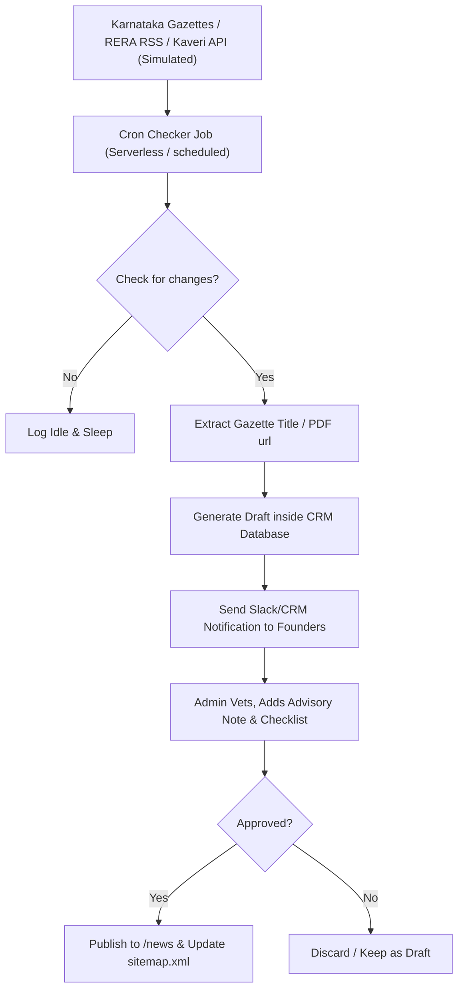

# NEWS UPDATE AUTOMATION FUTURE PLAN

This plan outlines the future safe, compliant automation architecture to monitor Karnataka government portals for land records, RERA rules, and stamps registrations updates.

---

## 1. Core Principles (Non-Negotiable)

1.  **No Automatic Publishing**: All updates fetched automatically must enter a `draft` review pipeline in the CRM dashboard. No automated script can publish updates to the public site without the founder's review.
2.  **Citation over Duplication**: Never scrape full text. Store key meta parameters (date, category, jurisdiction, PDF source links) and generate original, advisory-focused summaries.
3.  **No Clickbait / Absolute Accuracy**: Summaries must match the legal parameters of the linked government notifications without sensationalized language.
4.  **Audit Logs**: Keep track of source checks, updates fetched, modification dates, and verifying admin names.

---

## 2. Automated Sourcing Architecture

---

## 3. Automation Modules

### A. Gazette RSS & PDF Monitor
- **Target**: Official Gazette registry RSS feed.
- **Workflow**: Parse XML updates every 24 hours. Filter for keywords: *“Stamp Duty”*, *“Registration”*, *“Guidance Value”*, *“BDA Layout”*, *“DC Conversion”*, *“Form 9”*, *“Form 11”*.
- **Data Capture**: Extract the Gazette circular date, number, title, and PDF link.

### B. Karnataka RERA Compliance Monitor
- **Target**: RERA project registration updates tables.
- **Workflow**: Monitor project query endpoints for new registrations in target pin-codes (e.g. Bangalore East/North growth corridors).
- **Data Capture**: Sync registration additions, promoter details, and RERA compliance grades.

### C. Single-Window Single Sign-On (SSO) CRM Integration
- **Retainers**: Incorporate external legal API connectors (such as Kaveri Online transaction alerts) directly into the CRM pipeline to track mutations and encumbrances.

---

## 4. Admin Vetting Checklist

Compliance managers must review these questions before approving any automated draft for publication:
- [ ] Is the official source link verified and active?
- [ ] Does the circular apply globally to Karnataka or specifically to BDA/BMRDA zones?
- [ ] Are the calculator rate assumptions affected? (If yes, update the stamp duty or registration presets).
- [ ] Has an MS Legacy advisory caution note been added to highlight buyer/investor risks?
- [ ] Are payment collection links or guaranteed ROI returns statements completely avoided?
