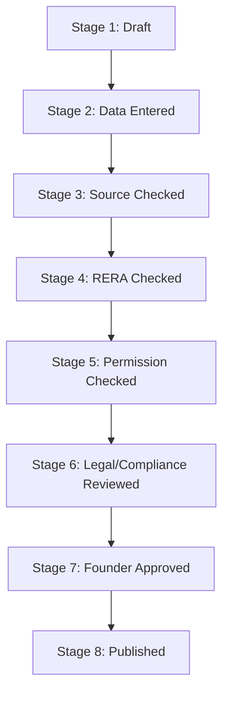

# Project Publishing Approval Workflow

This document details the mandatory approval stages required before any project catalog record is toggled to `published` in the CRM dashboard.

---

## 1. Approval Stages Workflow

### Stage 1: Draft
Initial import or manual insertion state. Default visibility: hidden.

### Stage 2: Data Entered
Catalog parameters completed (locality, city, tower count, starting values).

### Stage 3: Source Checked
Verify information sources match official developer releases or registered directories.

### Stage 4: RERA Checked
Confirm RERA registration number and RERA approval status against state portals.

### Stage 5: Permission Checked
Verify logo and brochure permissions inside the **Logo & Media Tracker**. If pending, confirm text placeholders are active.

### Stage 6: Legal & Compliance Reviewed
Complete title search overview mutational checks. Verify description copy contains **zero** instances of ROI guarantees or collective share investment vocabulary.

### Stage 7: Founder Approved
Final approval clearance signed off by the chief admin/founder.

### Stage 8: Published
Toggle visibility status to public.
